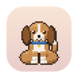
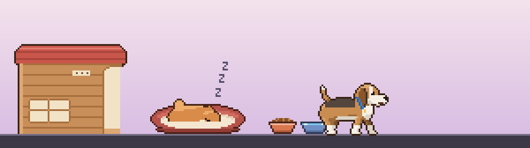
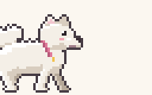
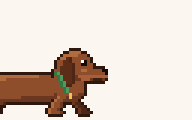
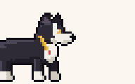

<div align="center">



# Little Companion

**A tiny pixel-art dog that lives at the bottom of your Mac's screen, and minds its own business.**

[**Download for macOS**](https://github.com/XclaimR/Little-Companion/releases/latest) · macOS 14 Sonoma or later · Apple silicon & Intel · free and open source



</div>

Little Companion isn't a game and it isn't a to-do list with a mascot. There's nothing to feed on a timer, no notifications, and nothing to keep alive. It's closer to having a real dog asleep in the corner of the room while you work. It naps, wanders off to sniff its toys, chases a ball for a minute, follows your cursor when it's curious, and sometimes just sits and looks at you, wagging its tail.

It lives on the desktop layer, under your windows. It never steals focus, never blocks a click and makes no sound. You can forget it's there, and that's the point.

## Meet the dogs

Each dog has its own hidden personality: playful or lazy, affectionate or independent, curious, energetic, a bit clumsy. You find it out by watching. Pick one from the 🐾 menu. You can switch whenever you like, and each dog remembers its own life.

|  |  |  |  |  |
|:---:|:---:|:---:|:---:|:---:|
| **Ollie**<br>beagle | **Biscuit**<br>shiba | **Mochi**<br>fluffy white pup | **Bean**<br>dachshund | **Pepper**<br>border collie |

## Things you'll catch them doing


- **Sleeping** in their bed, curled up, sprawled or belly-up, with little z's drifting up. Each dog has a favourite position, and twitches when dreaming.
- **Playing**: chasing and pouncing on the ball, carrying toys around, shaking the plush, tossing the rope in the air.
- **Noticing you**: a glance at the cursor, turning to face it, or trotting after it, depending on the dog's mood and personality.
- **Wagging** when they're happy, more when they're looking at you.
- **Grooming**: licking a paw, scratching an ear.
- **Zoomies**, jumps, the odd stumble if they're clumsy, and a sheepish look back afterwards.
- **Heading into the kennel** when your Mac is working hard, so they're out of the way, and coming back out once it's calm.

## Install

1. Download **LittleCompanion-x.y.z.zip** from the [latest release](https://github.com/XclaimR/Little-Companion/releases/latest) and open it.
2. Drag **Little Companion** into your **Applications** folder and open it.
3. The first time, macOS may say it can't check the app for malicious software, because the app isn't notarized by Apple. Click **Done**, then open **System Settings › Privacy & Security**, scroll down and click **Open Anyway** next to Little Companion. You only need to do this once.

Your dog appears at the bottom of the screen, just above the Dock. Everything else is in the 🐾 menu-bar icon:

- **Change dog**: switch between Ollie, Biscuit, Mochi, Bean and Pepper.
- **Open at login**: so your dog is there every morning.
- **Quit**: your dog's life is saved and picks up where it left off.

To uninstall, quit from the 🐾 menu and drag the app to the Trash. Saved dogs live in `~/Library/Application Support/LittleCompanion` if you want to remove them too.

## FAQ

**Will it slow my Mac down?**
No. It's native Swift and Core Animation, at about 0.6% CPU while walking and close to zero while asleep. When your Mac is busy, the dog goes into its kennel.

**Does it collect any data or go online?**
No. There's no network code at all. Everything stays in one file on your Mac.

**Can I pick it up, drag it or tell it what to do?**
No, on purpose. It's a little living thing, not a toy you control. Clicking near a sleeping dog may wake it, and it notices your cursor, but it decides for itself.

**It hasn't moved for ages.**
It's probably asleep. Dogs sleep a lot, especially at night and after lunch.

## Build from source

You need macOS 14 or later and the Xcode Command Line Tools (Swift 6).

```sh
git clone https://github.com/XclaimR/Little-Companion.git
cd Little-Companion
swift run -c release LittleCompanion
```

To make the double-clickable app and a zip for a release:

```sh
scripts/package.sh 0.1.0      # dist/Little Companion.app and dist/LittleCompanion-0.1.0.zip
```

### For developers

- `swift test` runs the behaviour engine's tests. `swift run -c release simrun 4 24 1` simulates 4 dogs for 24 hours and checks invariants.
- `LC_DEBUG=1` adds an overlay and a Test menu. `LC_SPEED=4` speeds time up. `LC_DEMO=1` runs a scripted tour. `LC_TOP=1` draws above your windows, for recording.
- The art is generated, not hand-pasted. `python3 tools/art/ollie_sheet.py tools/art <breed>` rebuilds a dog's sprite sheet. `python3 tools/art/readme_media.py` rebuilds the pictures in this README.
- [DESIGN.md](DESIGN.md) covers the design, how the behaviour engine thinks, and the roadmap.

## Contributing

Ideas, bug reports and pull requests are welcome. Please open an issue first for anything big. The one rule: nothing that makes the dog demand attention.

## License

[MIT](LICENSE) © 2026 Nishanth Korupolu
